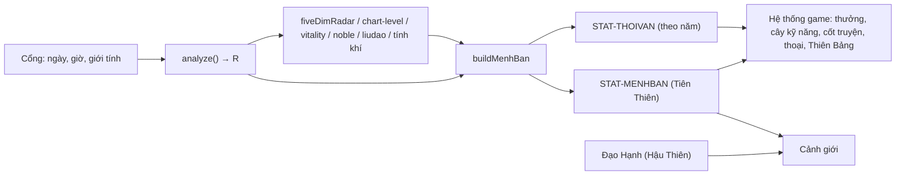

# 04 · Nhân vật từ bát tự — đặc tả chỉ số

> Tài liệu chuẩn chi tiết cho **Mệnh Bàn** (bảng chỉ số nhân vật) của *Huyền Giới · Mệnh Do Ta Tạo*.
> Nở từ `docs/GAME-AAA-THIET-KE.md` §4 và tuân thủ tuyệt đối `docs/gdd/00-KINH-DIEN-CHUNG.md` (canon) §5.
> Không gian tên được tạo mã: **`STAT-*`** và **`PERK-<sao>`** (canon §9).

## 1. Phạm vi

Tài liệu này trả lời đúng một câu: **từ ngày giờ sinh của người chơi, game sinh ra những con số nào, mỗi con số lấy từ trường nào của engine, biến đổi ra sao, và tác động gì lên lối chơi.**

Nằm trong phạm vi:

- Đặc tả từng chỉ số canon §5: nguồn, công thức, thang, làm tròn, chữ hiển thị, chú giải «Vì sao?», tác động bằng số, tương tác, ca biên.
- Bảng đầy đủ cho mọi bậc / mọi thực thể engine sinh ra: 10 Phẩm căn, 6 Phúc phận, 5 Ngũ Hành Lực, 5 mức Thân Lực, 5 trục Ngũ Duy (60 nút kỹ năng), 4 Mệnh Cách + 24 cách cục engine biết, 6 Mệnh Cấp, 30 Đặc Tính (`PERK-*`), 6 cõi Lục Đạo, 10 Tính Khí, 30 nạp âm, 17 tổ hợp thập thần, thang Thời Vận.
- Công thức Hậu Thiên: Đạo Hạnh, Hệ số Nghịch Thiên, Cảnh giới; bảng cân bằng thời gian lên cảnh giới.
- 15 lá số mẫu chạy engine thật (`MAU-A` … `MAU-O`), ghi đủ đầu vào để chạy lại.
- Ca biên (giờ không rõ, giờ Tý, tiết khí, múi giờ, âm lịch, tháng nhuận, giới hạn năm, Sửa bát tự).
- Giao diện Mệnh Bàn, lược đồ dữ liệu `STAT-MENHBAN`, kế hoạch kiểm thử.
- Ngôn từ an toàn (trụ cột T2, T6).

Ngoài phạm vi (dẫn chiếu sang tài liệu khác): số Đạo Hạnh của từng hoạt động (09), cơ chế Sổ Công Quá và nghiệp (05), mã nhiệm vụ `MQ-*`/`BR-*`/`SQ-*` (03), giao diện chung `UI-xx` (12), bảng dữ liệu kỹ thuật `SCHEMA-*` (13).

## 2. Tóm tắt một trang

1. `chart.js › analyze(y, m, d, h, mi, gender, refYear)` chạy **một lần** khi nhập bát tự ở cổng. Mọi chỉ số Tiên Thiên lấy từ kết quả `R` này và các hàm đọc `R` (`fiveDimRadar`, `classifyChartLevel`, `analyzeVitality`, `analyzeNobleStars`, `computeLiuDao`, `getPersonalityProfile`, `dayNayinPersonality`). **Không có công thức bói mới.**
2. Game chỉ thêm **lớp chuyển đổi** (tầng, hệ số, ngưỡng) để số của engine thành tác động lối chơi. Mọi lớp chuyển đổi đều **chỉ cộng, không trừ**: lá số «thấp» không bao giờ bị phạt, chỉ được trao thử thách có thưởng (trụ cột T2).
3. Chỉ số Tiên Thiên **bất biến theo năm tham chiếu**: đã kiểm, `MAU-A` chạy với `refYear` 2000 / 2026 / 2040 đều cho Tiềm Lực 41, Mệnh Cấp 清贵. Chỉ **Thời Vận** và **sinh lực hiện tại** đổi theo năm thật.
4. Hậu Thiên = **Đạo Hạnh**, nhân **Hệ số Nghịch Thiên** `clamp(1 + (60 − Tiềm Lực)/100, 1,0, 1,5)`. Cảnh giới bậc 1–3 tính `Tiềm Lực × 0,4 + Đạo Hạnh`, từ bậc 4 chỉ tính Đạo Hạnh. Kết quả cân bằng: với cùng nỗ lực 40 công tu/ngày, Phàm Căn (20 điểm) tới bậc 6 sau 81 ngày, Thiên Linh Căn (85) sau 113 ngày.
5. Phân bố thật (quét 5.000 lá số 1950–2009): Nghịch Thiên 50,9% · Đắc Cứu 32,2% · Dị Cách 15,0% · Thuận Thiên 1,9%. Thiên Linh Căn (≥ 86) dưới 0,1%. Vì vậy **lộ Nghịch Thiên là lộ chính của đa số người chơi** — tài liệu 03 cần viết nó là lộ «hạng nhất», không phải nhánh phụ.
6. Mọi chỉ số có nút **«Vì sao?»** đọc thẳng `synthesis.factors`; đã kiểm trên 4.000 lá số: `45 + Σ Δ(factor) = score` khớp **100%**.

## 3. Mục lục

Bảng có dòng dài, nên số dòng tệp ít hơn lượng nội dung thực.

**A. Đặc tả chỉ số (chuẩn)**

| Tệp | Nội dung | Dòng |
|---|---|---|
| `04-01-tong-quan.md` | Nguyên tắc, luồng dữ liệu, đường ống `buildMenhBan`, bảng 32 chỉ số, làm tròn, tất định, phiên bản engine, ma trận tác động, trần cộng dồn, phân bố 5.000 lá | 292 |
| `04-02-tiem-luc-pham-can-phuc-phan.md` | Tiềm Lực, bách phân vị, «Vì sao?» (17 nhóm factor, bộ tách Δ), 10 Phẩm căn, 6 Phúc phận, chuỗi «Khổ tận cam lai», «Khởi Sắc Muộn» | 341 |
| `04-03-ngu-hanh-than-luc-thien-menh.md` | Ngũ Hành Lực (5 thuộc tính × 6 tầng × 5 tác động), Bổ Hành, Thân Lực 5 mức, Thiên Mệnh 5 vai, hành của vùng / giờ / mùa | 311 |
| `04-04-ngu-duy.md` | Ngũ Duy, hệ số thiên phú, Ngộ, Bổ Khuyết, 5 cây × 12 nút | 226 |
| `04-05-menh-cach-menh-cap-nguyen-khi.md` | 4 Mệnh Cách, 24 cách, mọi `via` bệnh, 5 vị thuốc, 6 lộ Dị Cách, 6 Mệnh Cấp, Nguyên Khí | 303 |
| `04-06-dac-tinh.md` | 30 Đặc Tính `PERK-*`, bậc I/II, 4 nhóm giọng, kiếp số, an toàn, Quý Khí | 490 |
| `04-07-tuc-nghiep-tinh-khi.md` | Lục Đạo (khung «hồi quang»), 3 thanh tâm ma, 10 Tính Khí, 30 nạp âm, 17 cờ tổ hợp | 277 |
| `04-08-dao-hanh-canh-gioi-thoi-van.md` | Đạo Hạnh, trần ngày, Nghịch Thiên, cảnh giới, bảng thời gian lên bậc (4 nhịp × 5 điểm), Thiên Bảng, Thời Vận | 292 |
| `04-11-ca-bien.md` | Giờ không rõ (đo trên quần thể), giờ Tý, giao tiết, múi giờ lịch sử, âm lịch / nhuận, giới hạn năm, Sửa bát tự | 295 |
| `04-12-giao-dien-schema-kiem-thu.md` | Giao diện vòng tròn, khả năng tiếp cận, lược đồ `STAT-MENHBAN`, tập công khai, kế hoạch kiểm thử với giá trị kỳ vọng | 452 |
| `04-13-an-toan-ngon-tu.md` | RB1–RB5 áp vào chỉ số, 22 câu dẫn `STAT-LOI-*`, danh sách chữ cấm, chế độ «Chỉ đường, không số» | 160 |

**B. Lá số mẫu và dữ liệu đo**

| Tệp | Nội dung | Dòng |
|---|---|---|
| `04-09-la-so-mau-1.md` | `MAU-A` … `MAU-H` đầy đủ Mệnh Bàn | 668 |
| `04-10-la-so-mau-2.md` | `MAU-I` … `MAU-O` (Thiên Linh Căn, Dị Cách, không rõ giờ, giờ Tý) | 574 |
| `04-18-mo-phong-can-bang.md` | Mô phỏng quần thể, núm chỉnh, thẻ hành cho hoạt động, rủi ro khai thác, chỉ báo theo dõi | 188 |
| `04-19-bang-tra-va-ca-kiem-thu.md` | Bảng tra thần sát, 60 Giáp Tý, ca kiểm thử cho mọi giá trị rời rạc | 327 |
| `04-22-hanh-trinh-mau.md` | 120 ngày đầu của bốn người chơi theo lịch can chi thật | 146 |
| `04-27-he-so-theo-hoat-dong.md` | Hệ số Đạo Hạnh theo 20 hoạt động cho 3 lá số thật, bảng chữ mẫu, khung giao diện phụ | 222 |
| `04-28-lich-thien-thoi-va-vung.md` | Lịch mùa 2026–2027, ma trận vùng × Dụng / Kỵ, 12 trạm, «Năm Hạn» theo Kỵ | 92 |

**C. Kịch bản và chữ**

| Tệp | Nội dung | Dòng |
|---|---|---|
| `04-14-kich-ban-chi-so-1.md` | Nhận Mệnh Bàn (4 nhánh), dạy «Vì sao?», Bổ Dụng × 5, Bổ Khuyết, cảnh giới 4, đọc lại lá số, Sửa bát tự | 389 |
| `04-15-kich-ban-chi-so-2.md` | Vị thuốc × 5, ải tâm ma (cấu trúc), ải Mạn, «Khổ tận cam lai», móc Tính Khí × 10, ải song nhận | 329 |
| `04-16-dac-tinh-moc-nhiem-vu.md` | Móc `PERK-*/Q*` cho 30 Đặc Tính, 4 ải kiếp số đầy đủ | 384 |
| `04-20-kich-ban-menh-cach-thoi-van.md` | Ải giữ cách, nút thắt Mệnh Đồ theo `via`, 6 lộ Dị Cách, cảnh sự kiện vận | 241 |
| `04-21-kich-ban-tuc-nghiep-quy-nhan.md` | 6 cảnh Túc Nghiệp, Bổ Khuyết 4 trục, kho 20 quý nhân, phản ứng 10 giọng × 6 NPC | 237 |
| `04-26-kich-ban-tam-ma-chuoi-an.md` | 15 tầng ải tâm ma đủ lượt, ải Mạn 5 nhường, chuỗi ẩn, Bổ Hỷ, lời tầng, Thân Lực, «Vượt Vận» | 269 |
| `04-30-ngu-duy-nguoi-dan.md` | 5 cảnh người dẫn cây, 60 lời mở nút | 147 |
| `04-31-loi-thay-doc-menh-ban.md` | Khuôn «Thầy đọc Mệnh Bàn» và đáp án vàng cho 15 mẫu | 172 |
| `04-17-bo-chu-giao-dien.md` | Bộ chữ giao diện (nhãn, tooltip, «Vì sao?», tầng, thông báo, cổng, aria) | 284 |
| `04-24-hoi-thay-ve-menh-ban.md` | Trợ giúp trong game, ~45 câu hỏi đáp | 173 |
| `04-29-bang-han-viet.md` | Bảng Hán – Việt cho mọi chữ Hán của chỉ số | 171 |

**D. Kỹ thuật và phụ lục**

| Tệp | Nội dung | Dòng |
|---|---|---|
| `04-23-tich-hop-ma-nguon.md` | Module mới, chữ ký hàm, điểm nối với `main.js`, `progress.js`, `cosmetics.js`, `vanmenh.js`, `thaitue.js` | 200 |
| `04-32-du-lieu-san-xuat.md` | Cấu hình máy đọc (JSON) cho toàn bộ lớp game | 165 |
| `04-25-phu-luc.md` | 12 đề nghị engine, chỉ mục `STAT-*` / `PERK-*`, thuật ngữ, câu hỏi mở | 131 |
| `04-33-nghiem-thu-tong-hop.md` | Nghiệm thu tổng hợp mọi phần (T / S / U / R / C), định nghĩa «xong» | 118 |

## 4. Luồng dữ liệu

```
┌──────────── Cổng Sơn Môn (main.js › showBirth) ─────────────┐
│ ngày dương lịch · giờ (hoặc «không rõ» → 12:00) · giới tính │
│ (tùy chọn, chưa có — cần làm) âm lịch + tháng nhuận, nơi sinh│
└──────────────────────────────┬───────────────────────────────┘
                               │ chuẩn hóa (04-11)
                               ▼
        chart.js › analyze(y, m, d, h, mi, gender, refYear)
        ├─ buildChart → ziShiRoll → tứ trụ, nạp âm, tàng can
        ├─ scoreWuXing → wx.score / wx.pct (+ không vong −50% tàng)
        ├─ analyzeStrength → effRatio, level, strong
        ├─ computeShensha → shensha {key: {at: [...]}}
        ├─ computePattern → pattern {type, name, vi}
        ├─ findYongShen → yong {primary, xi, ji, chou, xian}
        ├─ patternQuality → quality, diseases[], rescues[]
        ├─ computeDaYun / computeLiuNian (+ cách cục, không vong, 源流)
        └─ synthesize → score, gradeVi, percentile, fortune, factors[], combos[]
                               │  R
          ┌────────────┬───────┼──────────┬──────────────┬─────────────┐
          ▼            ▼       ▼          ▼              ▼             ▼
   fiveDimRadar  classifyChart analyzeVit analyzeNoble computeLiuDao  personality
   (R.chart)     Level(R)      ality(R)   Stars(R)     (R)            + nayin (R)
          └────────────┴───────┴──────────┴──────────────┴─────────────┘
                               │
                               ▼
               buildMenhBan(R, birth, refYear)  ← chưa có — cần làm (04-01 §4)
                               │  STAT-MENHBAN (bất biến) + STAT-THOIVAN (theo năm)
     ┌──────────┬──────────────┼─────────────┬───────────────┬───────────────┐
     ▼          ▼              ▼             ▼               ▼               ▼
 Sổ Mệnh /   Thưởng hoạt    Cây kỹ năng   Mở màn cốt      Thoại NPC /     Thiên Bảng
 Mệnh Bàn    động (×hệ số)  Ngũ Duy       truyện BR-*     Thầy AI brief   (Tiên/Hậu Thiên)
 (UI)        (09)           (04-04)       (03)            (06)            (10)
```

Sơ đồ Mermaid (cho công cụ hiển thị được):



## 5. Mã định danh mới

### 5.1 `STAT-*` (chỉ số và cờ)

| Mã | Tên trong game | Phần |
|---|---|---|
| `STAT-MENHBAN` | Đối tượng Mệnh Bàn (lược đồ) | 04-12 |
| `STAT-TIEMLUC` | Tiềm Lực | 04-02 |
| `STAT-BACHPHAN` | Bách phân vị | 04-02 |
| `STAT-VISAO` + `STAT-VISAO-F01…F17` | «Vì sao?» và 17 nhóm lý do | 04-02 |
| `STAT-PHAMCAN` + `STAT-PHAMCAN-01…10` | Phẩm căn | 04-02 |
| `STAT-PHUCPHAN` + `STAT-PHUCPHAN-1…6` | Phúc phận | 04-02 |
| `STAT-NHL-MOC/HOA/THO/KIM/THUY` | Ngũ Hành Lực | 04-03 |
| `STAT-NHL-TANG` | Tầng hành (0–5) | 04-03 |
| `STAT-BOHANH` | Bổ Hành (Hậu Thiên) | 04-03 |
| `STAT-THANLUC` | Thân Lực | 04-03 |
| `STAT-THIENMENH`, `STAT-HYHANH`, `STAT-KYHANH`, `STAT-CUUHANH`, `STAT-NHANHANH` | Dụng / Hỷ / Kỵ / Cừu / Nhàn | 04-03 |
| `STAT-THIENTHOI` | Hành của vùng / giờ / mùa | 04-03 |
| `STAT-NGUDUY-TAI/QUAN/AN/THUC/TY` | Ngũ Duy | 04-04 |
| `STAT-ND-<TRỤC>-01…12` | Nút cây kỹ năng | 04-04 |
| `STAT-BOKHUYET` | Chuỗi Bổ Khuyết | 04-04 |
| `STAT-MENHCACH` + `STAT-MENHCACH-TT/DC/NT/DK` | Mệnh Cách | 04-05 |
| `STAT-VITHUOC-<nhóm>` | Vị thuốc (lộ Đắc Cứu) | 04-05 |
| `STAT-MENHCAP` | Mệnh Cấp | 04-05 |
| `STAT-NGUYENKHI` | Nguyên Khí | 04-05 |
| `STAT-QUYKHI` | Quý Khí | 04-06 |
| `STAT-TUCNGHIEP` | Túc Nghiệp | 04-07 |
| `STAT-TAMMA-THAM/SAN/SI` | Ba thanh tâm ma | 04-07 |
| `STAT-TINHKHI` | Tính Khí | 04-07 |
| `STAT-NAPAM` | Danh xưng nạp âm | 04-07 |
| `STAT-FLAG-<combo>` | 17 cờ tổ hợp thập thần | 04-07 |
| `STAT-THOIVAN-DV`, `STAT-THOIVAN-LN` | Thời Vận đại vận / lưu niên | 04-08 |
| `STAT-DAOHANH` | Đạo Hạnh | 04-08 |
| `STAT-NGHICHTHIEN` | Hệ số Nghịch Thiên | 04-08 |
| `STAT-CANHGIOI` | Cảnh giới | 04-08 |
| `STAT-CANCO` | Căn Cơ (= Tiềm Lực × 0,4) | 04-08 |
| `STAT-LOI-01…22` | Câu dẫn an toàn | 04-13 |
| `STAT-CANH-<nhóm>-<số>` | Cảnh kịch bản do chỉ số kích hoạt (mô-đun 03 gọi tới) | 04-14, 04-15, 04-20, 04-21, 04-26, 04-30 |

### 5.2 `PERK-*` (30 Đặc Tính)

29 khóa `computeShensha` + 1 khóa `noble-stars` (`guoYin`):
`PERK-tianYi`, `PERK-wenChang`, `PERK-luShen`, `PERK-yangRen`, `PERK-xueTang`, `PERK-taoHua`, `PERK-yiMa`, `PERK-jiangXing`, `PERK-huaGai`, `PERK-tianYiMed`, `PERK-tianDe`, `PERK-yueDe`, `PERK-yueDeHe`, `PERK-tianDeHe`, `PERK-dexiu`, `PERK-ciGuan`, `PERK-jinYu`, `PERK-hongYan`, `PERK-kuiGang`, `PERK-taiJi`, `PERK-tianChu`, `PERK-liuXia`, `PERK-xueRen`, `PERK-zaiSha`, `PERK-shiLing`, `PERK-tianShe`, `PERK-siFei`, `PERK-jinShen`, `PERK-sanQi`, `PERK-guoYin`.

Móc nhiệm vụ của Đặc Tính ghi dạng `PERK-<sao>/Q1`, `/Q2`… (mã nhiệm vụ chính thức `SQ-*`/`BR-*` do tài liệu 03 cấp).

## 6. Phát hiện khi rà engine (ảnh hưởng thiết kế)

| # | Phát hiện | Hệ quả cho game | Đề xuất |
|---|---|---|---|
| E1 | `patternQuality` với `pattern.type === 'special'` trả `成格 / 有救 / 败格` (audit 2026-09), **không** trả `特殊` cho 3 loại đã nhận diện (`cong`, `zhuanwang`, `huaqi`). `特殊` chỉ còn là nhánh dự phòng. | Không thể ánh xạ «Dị Cách» bằng `quality === '特殊'`. | Mệnh Cách = Dị Cách khi `pattern.type === 'special'`; chất lượng là **trạng thái con** (04-05 §2). |
| E2 | `synthesis.factors` là chuỗi văn bản, không có trường số. | «Vì sao?» phải tách Δ từ chuỗi. | Bộ tách tạm (đã kiểm 4.000/4.000) ở 04-02 §3.3; xin engine thêm `factorsStructured` (**chưa có — cần làm**). |
| E3 | `analyzeVitality` đọc `R.asOfYear` / `R.now`, `analyze()` không đặt → rơi về `new Date()`. | `currentVitality` không tất định. | `buildMenhBan` gán `R.asOfYear = refYear` trước khi gọi (04-01 §4). |
| E4 | `computeLiuNian` đánh dấu `isNow` theo **năm dương lịch**, nhưng năm can chi đổi ở **Lập Xuân** (~4/2). | 1/1 → 3/2: Thời Vận lưu niên sai năm. | `refYear` của game tính theo Lập Xuân (04-11 §6). |
| E5 | `SHENSHA_INFO.kuiGang.vi = 'Quù Cương'`, `tianChu.vi = 'Thiên Xư'` (lỗi chữ). | Không hiển thị thẳng `vi` của engine. | Game dùng tên riêng «Khôi Cương», «Thiên Trù» (04-06). |
| E6 | `classifyChartLevel.levelVi` của 下格 chứa chữ «bần tiện». | Vi phạm T2 nếu hiển thị. | Không bao giờ hiển thị `levelVi`; dùng tên game (04-05 §4). |
| E7 | `noble-stars` tính `taiji` chỉ theo can ngày; `shensha.taiJi` theo can ngày **và** can năm. | Hai nguồn có thể lệch. | Đặc Tính dùng `shensha.taiJi` (rộng hơn); `noble-stars` chỉ dùng cho `assessment` (04-06 §4). |
| E8 | Giờ sinh quyết định rất mạnh: trên 400 ngày sinh, Phẩm căn đổi theo giờ ở 100%, lớp Mệnh Cách ở 73,8%, Dụng thần ở 85,5%; biên độ Tiềm Lực trung vị 29 điểm. | Người không rõ giờ có Mệnh Bàn «tạm». | Khoảng Tiềm Lực, chấm «?», mở màn trung tính (04-11 §2). |
| E9 | `liunian.score` có thể **âm** sau tầng cách cục (gặp −1). | Giao diện giả định 0–100 sẽ vỡ. | Chỉ hiển thị tên mức, không hiện số âm (04-19 §8). |
| E10 | Game đã có `thaitue.js › suiYear()` tính năm theo Lập Xuân. | Không cần hàm mới cho E4. | `refYear = suiYear(now).year` (04-08 §6.4). |

## 7. Câu hỏi mở (tóm tắt — đủ 10 câu ở 04-25 §5)

1. Lộ Nghịch Thiên chiếm ~51% người chơi: tài liệu 03 có chấp nhận mở màn «Sơn Môn từ chối» cho số đông?
2. Cột «Tiên Thiên» trên Thiên Bảng: canon nói có 2 cột; tài liệu này đặt **mặc định ẩn, người chơi tự bật** để chống so bì. Cần chốt với 10.
3. Hoa Cái ở bản sơ đồ tổng §4.6 có «giao lưu −10%»; tài liệu này bỏ phần trừ (T2 + yêu cầu «không phạt»). Cần cập nhật sơ đồ tổng.
4. Ngân sách Đạo Hạnh/ngày (40 công tu chuẩn) là giả định tham chiếu; tài liệu 09 chốt số thật cho từng hoạt động.
